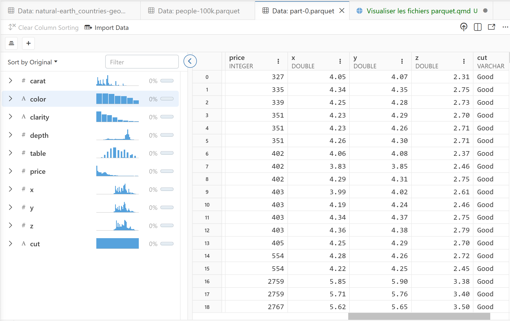
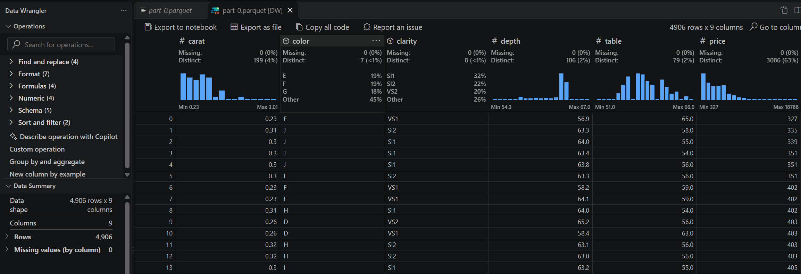

# Pourquoi Parquet, j'ai déja CSV !

- le schéma avec typage des colonnes (les dates sont des dates)
- les jeux de donnée de grande taille (compression)
- la lecture à distance sans téléchargement
- la lecture selective (fichier plus gros que la RAM)
- la haute performance (orienté colonne)

# Le format Parquet, un bref historique

- Specification version 1 en Juillet 2013 (version 26.0.1 la semaine
  dernière)
- Apache Software Fundation Top Level projet en Avril 2015
- Premier commit en Fevrier 2016.
- Apache **Arrow Flight**, le serveur d'échange entre machines Oct 2019
- **nanoarrow** en Mars 2023.
- Spécification de **GeoArrow** en Sept 2023.
- Adoption par **le hackaviz de TDV** en Janvier 2024
- Adoption par **data.gouv.fr** en Décembre 2024

# L'outillage

## Positron



## VS Code Data Wrangler Extension (Microsoft)



------------------------------------------------------------------------

## Tableau comparatif{.smaller}

| Outil | Type | HTTPS / S3 (distant) | GeoParquet | Multi-fichiers (Dataset) | Remarques clés |
|:-----------|:-----------|:----------:|:----------:|:----------:|:-----------|
| **DuckDB** | CLI / SQL | ✅ | ✅ | ✅ | La solution sans fautes. `httpfs` pour le distant, extension `spatial` pour le geo, glob + hive partitioning pour les datasets. |
| **arrow** | CLI | ✅ | ✅ | ✅ | La solution standard. `httpfs` pour le distant, extension `spatial` pour le geo, glob + hive partitioning pour les datasets. |
| **nanoarrow** | CLI | ❌ | ❌ | ❌ | La solution minimaliste pour les fichiers locaux |
| **Polars** | R / Python / Rust | ✅ | ❌ | ✅ | Excellent en distant (`read_parquet("https://…")`) et multi-fichiers (`scan_parquet("*.parquet")`). Pas de types géo natifs |
| **Positron** | IDE Data | ❌ | ✅ | ❌ | Le Data Explorer s'appuie sur les fichiers locaux. Pas de rendu, mais compréhension du géospatial natif |
| **VS Code + Data Wrangler** | IDE + Ext. | ❌ | ❌ | ❌ | Orienté fichier local unique. Pour le distant ou le multi-fichiers, il faut d'abord charger en Python. Aucune interprétation des géométries. |
| **VisiData** | TUI (Terminal) | ⚠️ | ❌ | ⚠️ | Peut ouvrir une URL mais télécharge tout en local d'abord. Les géométries WKB apparaissent comme des blobs binaires illisibles. Multi-fichiers via glob mais sans hive partitioning. |
| **Datasette** *(+ plugins)* | Web App | ⚠️ | ✅ | ⚠️ | **La surprise géospatiale.** Le plugin `datasette-parquet` est local, mais couplé à `datasette-geojson-map` et `datasette-spatialite`, c'est le **seul outil du panel qui affiche une carte interactive** des géométries. |
| **Tad** | GUI Desktop | ❌ | ❌ | ❌ | Strictement local, fichier unique, pas de géo. Très bon pour un coup d'œil rapide sur un CSV/Parquet simple, mais s'arrête là. |
| **parquet-tools** | CLI (Java/Go) | ❌ | ⚠️ | ❌ | Utile pour inspecter le **schéma** et les métadonnées GeoParquet (crs, bbox), mais n'interprète ni ne visualise les géométries. |

> **Légende :** ✅ Bon · ⚠️ Partiel /
> contournable · ❌ Non supporté

------------------------------------------------------------------------

### Zoom sur les 3 cas difficiles

#### 1. 🌐 Parquet à distance (HTTPS / S3 / GCS)

Le défi est de pouvoir **requêter un fichier sans le télécharger en
entier** (protocole http:// ou s3:// ou gs:// ).

- **DuckDB** couvre le domaine. L'extension `httpfs` permet de faire :

```{sql}
INSTALL httpfs; LOAD httpfs;
SELECT * FROM 'https://example.com/data.parquet' LIMIT 10;
-- ou directement sur S3 :
SELECT * FROM 's3://mon-bucket/data/*.parquet';
```

```         
Il ne télécharge que les row groups nécessaires grâce aux métadonnées Parquet (footer). C'est du **zero-copy à distance**.
```

- **Polars** gère aussi très bien le HTTPS nativement
  (`pl.read_parquet("https://…")`), mais pour S3/GCS il faut configurer
  les credentials via `storage_options`.

- **Datasette** et **VisiData** sont à la traîne : ils nécessitent un
  téléchargement préalable ou une étape intermédiaire.

#### 2. 🗺️ GeoParquet

Le GeoParquet est un Parquet standard avec des colonnes de géométrie
encodées en WKB et des métadonnées CRS dans le footer. Le défi est
double : **lire les géométries** et **les visualiser sur une carte**.

- **DuckDB + extension `spatial`** : Lit les géométries, fait des
  requêtes spatiales (ST_Intersection, ST_Within…), et peut exporter en
  GeoJSON. Pas de carte native dans le CLI, mais le résultat peut être
  envoyé vers n'importe quel outil de viz.

```{sql}
INSTALL spatial; LOAD spatial;
SELECT ST_AsText(geom) FROM 'data.geoparquet' LIMIT 5;
```

- **Datasette** est le **seul outil qui offre une visualisation
  cartographique interactive** out-of-the-box. Le workflow est :

  1.  Convertir le GeoParquet en GeoJSON ou SpatiaLite (via `ogr2ogr` ou
      DuckDB).
  2.  Charger dans Datasette avec `datasette-geojson-map`.
  3.  Les points/polygones s'affichent sur une carte Leaflet interactive
      dans le navigateur.

  C'est plus de friction à l'entrée, mais le résultat final est **le
  plus parlant pour un public non-technique**.

- **Positron** : Pas de carte native dans le Data Explorer
  *aujourd'hui*, mais dans la console intégrée, un
  `geopandas.read_parquet("data.geoparquet").plot()` ou
  `mapview::mapview()` en R fonctionne immédiatement. C'est un
  contournement très efficace.

#### 3. 📁 Dataset Parquet (Multi-fichiers / Hive Partitioning)

Le cas typique : un dossier `data/` contenant
`year=2023/month=01/part-000.parquet`,
`year=2023/month=02/part-000.parquet`, etc.

- **DuckDB** gère cela nativement avec le hive partitioning :

```{sql}
SELECT * FROM read_parquet('data/**/*.parquet', hive_partitioning=true);
```

```         
Il infère automatiquement les colonnes de partition (`year`, `month`) depuis la structure des dossiers.
```

- **Polars** est tout aussi capable :

```{python}
import polars as pl
from pyhere import here

pl.scan_parquet(here("data/**/*.parquet"), extra_columns='ignore', missing_columns='insert').collect()
```

- **Positron** hérite de ces capacités via son backend DuckDB/Arrow.
  Vous pouvez ouvrir un dossier complet dans le Data Explorer.

- Les autres outils (VisiData, Data Wrangler, Tad, Datasette) sont
  essentiellement **fichier par fichier**. Pour un dataset partitionné,
  il faut d'abord concaténer ou passer par du code.

------------------------------------------------------------------------

### 💡 Recommandations par cas d'usage

| Votre situation | Outil recommandé |
|:-----------------------------------|:-----------------------------------|
| **Un fichier Parquet sur un bucket S3, requête rapide** | **DuckDB** (`httpfs` + SQL) |
| **Un GeoParquet à explorer visuellement sur une carte** | **Datasette** (via GeoJSON) ou **Positron** (via GeoPandas/sf dans la console) |
| **Un dataset partitionné de 50 Go en Hive format** | **DuckDB** ou **Polars** (les seuls à gérer le hive partitioning nativement) |
| **Exploration quotidienne interactive (local + distant)** | **Positron** (le meilleur compromis IDE + puissance DuckDB en backend) |
| **Partager une exploration avec des collègues non-tech** | **Datasette** (interface web, filtres facettés, carte interactive) |

En résumé, **DuckDB est le moteur sous-jacent qui résout les 3 cas
difficiles**, et **Positron est l'interface la plus agréable** pour en
tirer parti au quotidien. **Datasette reste unique** pour la
visualisation géospatiale web et le partage collaboratif.

------------------------------------------------------------------------

```{shell}
uv init -p313 -n datasette_software
cd datasette_software
uv add datasette
uv tool install datasette --with datasette-parquet 
uv tool install datasette --with datasette-geojson-map
```